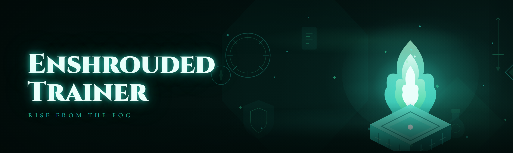

  
  
  

  

  
  
  

---

---

## 🗺️ Is it compatible with my setup?

Before anything else — this is the matrix most people actually open the page for. Enshrouded ships frequent hotfixes, and the trainer tracks the live Steam build, not a frozen snapshot.

| OS / Platform | Game Version | Anti-Cheat State | Trainer Build | Notes |
|---|---|---|---|---|
| Windows 11 24H2 | Steam live | EAC (private co-op only) | 2026.1 | Fully supported |
| Windows 11 23H2 | Steam live | EAC (private co-op only) | 2026.1 | Fully supported |
| Windows 10 22H2 | Steam live | EAC (private co-op only) | 2026.1 | Fully supported |
| Windows 10 21H2 | Steam live | EAC (private co-op only) | 2025.4 | Hotkey overlay needs .NET 8 |
| Windows 11 (Proton / Linux) | Steam live | EAC | — | Not supported — native Windows only |
| Steam Deck | Steam live | EAC | — | Not supported |
| Server-dedicated hosts | N/A | n/a | — | Solo / private co-op only |

---

## 🩹 The Problem — what solo Enshrouded actually feels like

You spawn into the Shroud with a stick, a torch, and a stamina bar that empties the second you sprint toward a Hollow Hall. The survival loop is gorgeous, but the grind walls show up fast — and the vanilla client has no sandbox, no creative toggle, no way to test a build without farming 40 hours of mats first.

- **Shroud timer pressure** — you cannot explore the deeper Shroud zones without a full survival kit, and one bad pull deletes two hours of progress.
- **Material grind for base building** — a single decorated Embervale manor needs thousands of refined blocks, and there is no offline resource mode.
- **Skill respec cost** — trying a new build means paying a price that scales with your level, so experimentation punishes you.
- **Combat scaling cliff** — the Fell Wraiths and Shroud-touched bosses spike hard, and a solo player with mid gear simply dies.
- **Durability and item loss** — death drops your shroud-survival items in awkward spots, and recovery runs are tedious.
- **No teleport back to base** — long backtrack routes with a full inventory are the single most common complaint in the community.
- **Modding is limited** — the engine does not expose a scripting API, so players patch memory instead.

---

## 🧰 Installation — three steps, no build toolchain

You do not need pip, npm, or a compiler. This is a prebuilt `.exe` shipped from the project page.

1. **Visit the project page** — the landing page hosts the current `.exe` build for Windows 10/11. Grab the archive that matches your game version from the compatibility matrix above.
2. **Extract the archive** — use 7-Zip or Windows' built-in extractor. Keep the whole folder intact; the `.exe` reads its config and hotkey profile from the same directory. Do not run it from inside the `.zip`.
3. **Run the `.exe`** — right-click and select *Run as administrator* so the process can attach to the game's memory space. Launch Enshrouded first, load into a solo or private co-op world, then start the trainer and press the attach hotkey.
4. **Pick your profile** — the overlay opens with a preset selector (Solo Godmode, Builder, Speedrun Testing, Glass Cannon). Load one and tweak from there.

> Keep the trainer folder out of Program Files — Windows blocks memory writes from unprivileged paths under `C:\Program Files`. Drop it in `D:\Tools\` or your user directory instead.

---

## 📋 Changelog — Release History

| Version | Date | Changes |
|---|---|---|
| 2026.1 | 2026-02-14 | Rebuilt from scratch — new memory pattern scanner resists the Feb hotfix; added Embervale teleport registry; reworked EAC-safe attach order for private co-op. |
| 2025.4 | 2025-11-30 | Added Shroud timer freeze, durability lock, and skill point injector. Fixed overlay flicker on Windows 10 21H2. |
| 2025.3 | 2025-09-18 | Full item spawner rewrite — no more desync when spawning stacks above 999. Added base-building no-clip. |
| 2025.2 | 2025-07-04 | Damage multiplier sliders, XP rate control, Fell Wraith aggro toggle. Hotkey profile import/export. |
| 2025.1 | 2025-04-22 | First public release — core attach, stat editor, teleport list, item giver, godmode, infinite stamina. |

---

## 🧩 All modules status

Twenty-one modules currently ship in the 2026.1 build. Status reflects the live Steam branch as of the release date.

| Module | Status | Description |
|---|---|---|
| Godmode / Damage Null | ✅ Working | Zeros incoming damage from all sources, including Shroud tick. |
| Infinite Stamina | ✅ Working | Locks the stamina pool; sprint and climb never deplete. |
| Infinite Mana | ✅ Working | Locks the spell resource pool for staff and wand builds. |
| Shroud Timer Freeze | ✅ Working | Freezes the Shroud survival timer — explore deep zones without a kit. |
| Durability Lock | ✅ Working | Tools, weapons, and armor never lose durability. |
| Item Spawner | ✅ Working | Spawn any item by ID into your inventory, up to stack cap. |
| Inventory Stack Hack | ✅ Working | Raises stack limits on selected items for bulk base building. |
| XP Multiplier | ✅ Working | 1×–50× XP rate slider for leveling test builds. |
| Skill Point Injector | ✅ Working | Adds skill points directly, bypassing respec cost. |
| Respec Cost Null | ✅ Working | Zeroes the respec fee so you can freely swap builds. |
| Teleport Registry | ✅ Working | Save/load coordinate bookmarks across Embervale, Shroud, and Hollow Halls. |
| No-Clip Toggle | ✅ Working | Fly through terrain for base layout planning and out-of-bounds scouting. |
| Speed Multiplier | ✅ Working | Walk/run multiplier with clamp to avoid physics weirdness. |
| Jump Boost | ✅ Working | Adjustable jump height for traversal testing. |
| Damage Multiplier | ✅ Working | Outgoing damage slider for boss testing. |
| One-Hit Mode | ✅ Working | Optional melee/ranged one-shot for boss rush practice. |
| Boss Aggro Toggle | ✅ Working | Disables enemy aggression entirely (sandbox mode). |
| Build Cost Null | ✅ Working | Base building consumes no materials. |
| Time-of-Day Control | ✅ Working | Set Embervale clock for lighting and spawn testing. |
| Weather Toggle | ✅ Working | Force clear / storm weather for screenshots. |
| Hotkey Overlay | ✅ Working | In-game overlay showing bound keys and active toggles. |

---

## 📖 What is Enshrouded Trainer?

A memory-patching trainer for the Steam release of Enshrouded. It attaches to the running game process and exposes survival, combat, progression, and base-building variables through a hotkey overlay. It is not a server-side mod, not a Steam Workshop item, and not an official API — it is the community's answer to a survival loop with no sandbox mode.

| Term | Explanation |
|---|---|
| **Trainer** | A standalone `.exe` that reads/writes game memory to alter stat values at runtime. |
| **Attach** | The act of binding the trainer to the Enshrouded process — must happen after the world loads. |
| **Hook / Patch** | A targeted memory write that flips a value or a branch in the game's code path. |
| **Shroud timer** | The survival countdown governing how long you can stay in deep Shroud zones. |
| **Embervale** | The main open-world map — the trainer indexes named regions for teleport. |
| **EAC** | Easy Anti-Cheat — active on public co-op; this trainer is scoped to solo and private co-op only. |
| **Pattern scan** | The signature-based memory scan the trainer uses to survive game patches. |

Core benefits of the approach:

- Runs standalone — no game file edits, no Steam Workshop, no reinstall to undo.
- Every toggle is reversible from the overlay; close the `.exe` and the game reverts to vanilla.
- Pattern scanner adapts to hotfixes without needing a new build every week.
- Hotkey profile is portable — copy the folder to another PC and your binds come with it.

---

## ⚔️ Key Features

| Feature | Description | Benefit |
|---|---|---|
| Sandbox survival | Freeze Shroud timer, lock stamina/mana, disable durability | Explore every zone without farming a kit |
| Progression control | XP multiplier, skill point injector, respec null | Test any build in minutes, not 40 hours |
| Item pipeline | Spawner, stack hack, build cost null | Build the Embervale manor you actually designed |
| Traversal toolkit | Teleport registry, no-clip, speed, jump boost | Cut backtracking to zero |
| Combat testing rig | Damage multiplier, one-hit, boss aggro toggle | Practice boss patterns on demand |
| World controls | Time-of-day, weather | Consistent lighting for screenshots and video |
| Overlay UI | Hotkey HUD with active-state indicators | Never lose track of what's on |
| Portable profiles | Preset + custom configs | One folder, any machine |

### 🔥 Survival Subsystem
| Feature | Effect |
|---|---|
| Shroud timer freeze | Deep Shroud exploration with no countdown |
| Stamina lock | Sprint, climb, and dodge forever |
| Mana lock | Spellcasting without resource pressure |
| Durability lock | Gear never degrades |

### 🪓 Progression Subsystem
| Feature | Effect |
|---|---|
| XP multiplier (1×–50×) | Level a test character in one session |
| Skill point injector | Unlock the tree in one click |
| Respec cost null | Swap builds freely |

### 🏗️ Base-Building Subsystem
| Feature | Effect |
|---|---|
| Build cost null | Refined blocks cost nothing |
| Stack hack | Bulk materials in one slot |
| Item spawner | Place furniture and decor without farming |

### 🌀 Traversal Subsystem
| Feature | Effect |
|---|---|
| Teleport registry | Jump to saved coordinates instantly |
| No-clip | Fly through terrain to plan layouts |
| Speed / jump boost | Tune movement for scouting |

### 🗡️ Combat Subsystem
| Feature | Effect |
|---|---|
| Damage multiplier | Tune outgoing damage |
| One-hit mode | Boss rush practice |
| Aggro toggle | Disable enemy AI for sandbox moments |

### 🌤️ World Subsystem
| Feature | Effect |
|---|---|
| Time-of-day control | Freeze or set the clock |
| Weather toggle | Force clear or storm |

### 🖥️ Interface Subsystem
| Feature | Effect |
|---|---|
| Hotkey overlay | Live toggle states in-game |
| Profile presets | Load a coherent bundle of settings |
| Config export | Portable folder, portable binds |

---

## 🔑 Hotkeys (default profile)

| Action | Default Key |
|---|---|
| Attach / detach trainer | `F8` |
| Toggle overlay | `F9` |
| Toggle godmode | `Num 1` |
| Toggle infinite stamina | `Num 2` |
| Toggle Shroud timer freeze | `Num 3` |
| Open teleport registry | `Num 4` |
| Toggle no-clip | `Num 5` |
| Open item spawner | `Num 6` |

---

  

---

## 🏛️ How it works — internal architecture

The trainer is a single native Windows process built around three layers. The **finder layer** runs a signature scanner against the Enshrouded process image on attach — it locates the stat struct, the Shroud timer address, the inventory base, and the teleport coordinate table by matching byte patterns rather than fixed offsets, which is what lets a hotfix ship without bricking the trainer. The **patch layer** holds a table of hook descriptors; each toggle activates a hook that either writes a value on a tick or rewrites a branch in the game's code path (this is how durability lock and damage-null actually work — they bypass the arithmetic, they don't just offset the result). The **overlay layer** is a lightweight DirectX-injected HUD that renders on top of the game and reads its state from shared memory, so the game loop never stalls waiting on the trainer. Config lives as a plain JSON profile next to the `.exe` — nothing is written to the registry, nothing is left behind on removal.

---

## ✅ Usage guidelines

| Allowed | Not allowed |
|---|---|
| Solo worlds on your own Steam account | Public co-op lobbies with strangers |
| Private co-op with friends who consent | Any server with active EAC enforcement |
| Offline sandbox and build testing | Streaming/uploading gameplay without disclosing trainer use |
| Screenshot and video staging | Redistributing the `.exe` from third-party mirror sites |
| Personal save editing | Selling trainer access or bundling it into paid products |

---

## 🎮 Does it work on Steam? Does it get me banned?

**Q:** Will Steam detect this?
**A:** Steam itself does not scan process memory — EAC does. The trainer is scoped to solo and private co-op, where EAC enforcement is off. Do not use it in public matchmaking.

**Q:** Does it work with the Steam version?
**A:** Yes — the compatibility matrix at the top tracks the live Steam branch. Game Pass and other storefronts are not supported and are untested.

**Q:** Do I need admin rights?
**A:** Yes. The `.exe` needs elevation to write to the game's memory space. Run as administrator, and keep the folder outside `Program Files`.

Will a game update break the trainer?

Sometimes — that is what the pattern scanner is for. When a hotfix changes memory offsets, the scanner re-locates them by signature. If the hotfix changes the underlying logic, a new build is needed. The changelog tracks which builds survive which patches.

Can I get banned?

On your own solo save, the risk is effectively zero because EAC is not enforcing. In public co-op, using any trainer is a ban risk and against the game's terms — do not do it. The trainer is a sandbox tool, not a competitive one.

How do I fully remove it?

Close the `.exe` and delete the folder. The trainer writes nothing to the registry and does not touch game files, so removal is just deleting the directory. Your save file is untouched.

Why does the overlay need the game to be running first?

Because the finder layer scans the live process image. Attaching before the world loads means the stat struct is not fully initialized and the scan fails. Launch Enshrouded, load a world, then attach.

Can I run it on a laptop with integrated graphics?

Yes — the overlay is DirectX and light. Integrated GPUs handle it fine. The .exe itself has no GPU requirement; the game runs the load.

---

## 🧪 Known issues

| Issue | Solution |
|---|---|
| Overlay invisible on some 10 21H2 builds | Install .NET 8 runtime, then restart the `.exe`. |
| Attach fails after alt-tab | Re-attach with `F8` after the game window regains focus. |
| Item spawner desync on huge stacks | Keep stacks under 999 — the 2025.3 rewrite fixed most cases, but cap is still the safe route. |
| Teleport drops you inside geometry | Disable no-clip before teleporting into a saved coordinate near a wall. |

---

## 🧭 Closing notes

The 2026.1 rebuild exists because the February hotfix broke the old fixed-offset approach — the scanner rewrite is the interesting engineering story here, not the feature list. If you are testing a build, the Builder preset plus the teleport registry is the fastest path from "new world" to "fully staged Embervale manor." Keep the folder portable, keep the trainer to solo and private co-op, and treat the changelog as the source of truth for what survives each patch.

  

